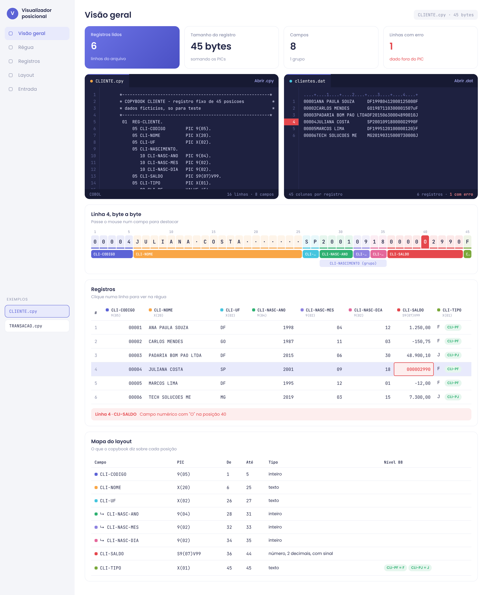

# Visualizador posicional (COBOL → Angular)

Tela em Angular 21 que lê um **copybook COBOL** e um **arquivo de largura fixa** (.dat) e mostra cada registro numa tabela, campo por campo.



## O que ela faz

- Calcula a posição inicial, final e o tamanho de cada campo a partir dos PICs.
- Mostra uma régua byte a byte do registro selecionado, com uma cor por campo.
- Converte os números com casas decimais implícitas (`V`), sem usar float.
- Lê o sinal embutido no último dígito de um `PIC S9` (padrão GnuCOBOL `p`-`y` e padrão EBCDIC `{`, `A`-`I`, `}`, `J`-`R`) e `SIGN SEPARATE`.
- Marca em vermelho o campo numérico com dado inválido e diz a posição do erro.
- Mostra qual nível 88 bateu em cada registro.
- Entende grupos (ex.: `CLI-NASCIMENTO` com ano, mês e dia) e `OCCURS`.
- Avisa quando encontra `REDEFINES` ou `COMP`/`COMP-3`, que não fazem sentido em arquivo texto.

## Como rodar

```bash
npm install
npm start
```

Abra http://localhost:4200. Os dois exemplos já vêm carregados, e também dá pra abrir seus próprios `.cpy` e `.dat`.

## Onde está cada coisa

| arquivo | o que faz |
| --- | --- |
| `src/app/cobol/copybook.ts` | lê o copybook e monta a lista de campos com posição e tamanho |
| `src/app/cobol/registro.ts` | corta cada linha do arquivo e converte os valores |
| `src/app/cobol/exemplos.ts` | os exemplos CLIENTE e TRANSACAO |
| `src/app/visualizador/` | a tela: signals para a entrada, `computed` para layout, tabela e régua |
| `exemplos/` | os mesmos exemplos em arquivo, pra testar o botão "Abrir" |

Os dados do exemplo CLIENTE são fictícios. A linha 4 tem um erro de propósito (letra O no lugar de zero no saldo).
